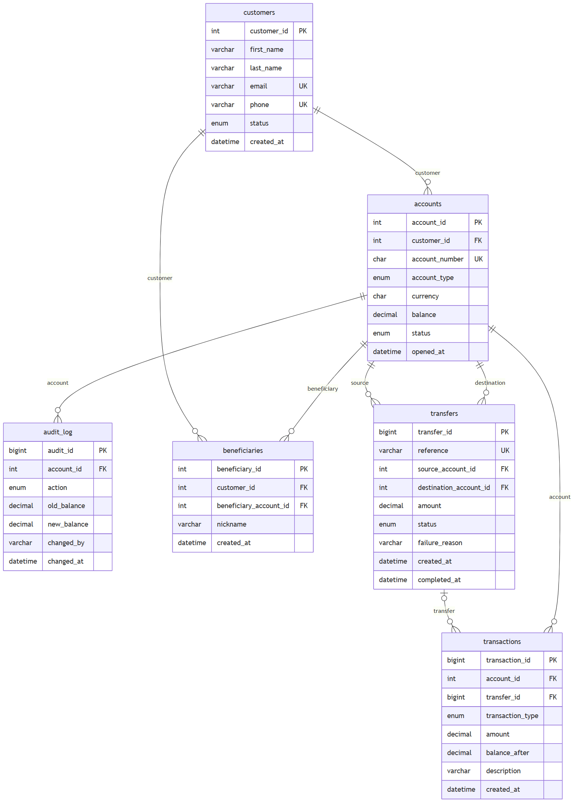

# Portfolio 1 — Database Design and Modelling (7 marks)

**Status:** Implemented and tested on MariaDB 10.4.32.

## Objective
Design and build the relational database for **MikePay**, a simulated fintech platform, and show that the design enforces its own rules: keys, constraints, normalisation, and an audit trail.

## Case study: MikePay
- **Organisation:** MikePay, a simulated retail fintech (payments) platform.
- **Nature of the system:** customers hold accounts and move money between them.
- **Users of the database:** customers, operations/support staff, auditors.
- **Major data stored:** customers, accounts, transactions (ledger), transfers, beneficiaries, audit records.
- **Key operations:** open an account; deposit; withdraw; transfer funds between accounts; save beneficiaries; record failed transfers with a reason; audit balance changes.

All data is synthetic (invented names, `example.com` emails, `0800000xxxx` phone numbers).

## ER diagram
Generated from the live database with a small helper script that I kept locally and did not include in this repository, so the diagram matches the real schema. The generated Mermaid source is included below.



Source: [diagrams/mikepay_er.mmd](diagrams/mikepay_er.mmd) (Mermaid).

## Relational schema (6 tables)
| Table | Purpose | Primary key | Foreign keys |
|---|---|---|---|
| customers | People who hold accounts | customer_id | none |
| accounts | Money-holding accounts | account_id | customer_id → customers |
| transfers | One row per transfer request | transfer_id | source_account_id, destination_account_id → accounts |
| transactions | Ledger: every balance movement | transaction_id | account_id → accounts; transfer_id → transfers (optional) |
| beneficiaries | Saved payees (MikePay accounts only) | beneficiary_id | customer_id → customers; beneficiary_account_id → accounts |
| audit_log | History of balance changes | audit_id | account_id → accounts |

Design choices that matter:
- **Money is `DECIMAL(15,2)`**, never floating point, so amounts are exact.
- **`CHECK (balance >= 0)`** stops a negative balance at the database level, whatever the application does.
- **Foreign keys use `ON DELETE RESTRICT`** for financial records, so a customer or account with history cannot be deleted. Beneficiaries are the one exception: deleting a customer removes their saved payees (`CASCADE`).
- **`transfers` records failures.** A `FAILED` transfer must carry a `failure_reason`, and it has no ledger rows.
- **Every transfer produces two ledger rows** (debit and credit). A `CHECK` ensures transfer legs link to a transfer and deposits/withdrawals do not.
- **Triggers** write an `audit_log` row whenever an account is opened or its balance changes.
- **Indexes** cover the foreign keys plus common lookups: transactions by account and date, transfers by status and date.

Normalisation (1NF → 2NF → 3NF, BCNF check, and deliberate denormalisation): see [normalisation.md](normalisation.md).

## How failed transfers are prevented from leaving balances inconsistent
Two layers work together:
1. **Constraint layer (built in this portfolio).** The database refuses a negative balance, a zero or negative amount, a transfer to the same account, and a failed transfer with no reason. A statement that breaks a rule is rejected as a whole.
2. **Transaction layer (Portfolio 3).** A transfer is two balance updates plus ledger rows. They must all succeed or all be undone, which needs a transaction (`START TRANSACTION` … `COMMIT` / `ROLLBACK`). That is implemented and tested in Portfolio 3. This portfolio only sets up the structure it depends on.

## Files
| File | What it does |
|---|---|
| [sql/01_create_schema.sql](sql/01_create_schema.sql) | Creates `mikepay_db` and the six tables (re-runnable) |
| [sql/02_triggers.sql](sql/02_triggers.sql) | Audit triggers on `accounts` |
| [sql/03_sample_data.sql](sql/03_sample_data.sql) | Synthetic data in one transaction |
| [sql/04_verification_queries.sql](sql/04_verification_queries.sql) | Shows constraints, keys, indexes and integrity checks |
| [sql/05_constraint_tests.sql](sql/05_constraint_tests.sql) | 13 statements that must be rejected |
| [normalisation.md](normalisation.md) | Normalisation explanation |

## How to run
Requires XAMPP MariaDB running on `localhost:3306`, user `root` with no password (default XAMPP). From this folder in **Git Bash**:

```bash
MYSQL=/c/xampp/mysql/bin/mysql.exe
$MYSQL -u root < sql/01_create_schema.sql
$MYSQL -u root < sql/02_triggers.sql
$MYSQL -u root < sql/03_sample_data.sql
$MYSQL -u root -t < sql/04_verification_queries.sql
$MYSQL -u root --force -n -t -vvv < sql/05_constraint_tests.sql
```

(`--force` lets the client continue after each expected error; `-n` keeps the output in order.) In PowerShell, use `Get-Content sql\01_create_schema.sql | & C:\xampp\mysql\bin\mysql.exe -u root` instead of `<`.

Script 01 drops and recreates the six MikePay tables, so it resets the database.

## Evidence (captured from real runs)
All files in [evidence/](evidence/) are raw output from the scripts above, run on 2026-11-03. They are command-line output, not screenshots.

| File | Shows |
|---|---|
| [01_run_schema_triggers_data.txt](evidence/01_run_schema_triggers_data.txt) | Schema, triggers and data loading without errors |
| [02_verification_output.txt](evidence/02_verification_output.txt) | Constraints, foreign keys, CHECKs, indexes, integrity checks, audit trail |
| [03_constraint_tests_output.txt](evidence/03_constraint_tests_output.txt) | All 13 rule-breaking statements rejected, with the error codes |
| [04_actual_schema_dump_no_data.sql](evidence/04_actual_schema_dump_no_data.sql) | `mysqldump --no-data` of the live schema (6 tables, 2 triggers) |

## Findings
- All six tables and both triggers were created with no errors. The `PRIMARY` name warning seen on the first run was removed by dropping the unused `pk_` names.
- Loading the sample data produced 8 customers, 9 accounts, 6 transfers (4 completed, 2 failed), 20 ledger rows, 5 beneficiaries and 28 audit rows.
- **All 13 constraint tests were rejected**, and row counts and balances were unchanged afterwards.
- **Integrity checks passed:** every account balance equals the sum of its ledger rows (9 of 9), the latest `balance_after` equals the balance (9 of 9), and every completed transfer has one debit and one credit that net to zero (4 of 4). Failed transfers have no ledger rows (2 of 2).
- The audit trail has an `ACCOUNT_OPENED` row for each account and a `BALANCE_CHANGED` row for each balance update, so balances can be traced step by step.

## Design decisions and limitations
- **SQL mode.** XAMPP's default `sql_mode` is not strict, so an invalid ENUM value would be silently altered instead of rejected. The scripts set strict mode for their own session. Other sessions that do not set it still use the server default.
- **MariaDB 10.4 specifics.** `CHECK` constraints are enforced; `EXPLAIN ANALYZE` is `ANALYZE` in MariaDB (used in Portfolio 2).
- **Balance and ledger agreement is checked by query, not enforced by a constraint.** Portfolio 3 handles this with transactions.
- **Beneficiaries are MikePay accounts only** (no external banks), and a customer can currently save their own account.
- **Single currency.** `currency` is stored but all data is NGN, and nothing prevents cross-currency transfers.
- **Failed INSERTs consume AUTO_INCREMENT values**, so ids created after running the constraint tests may skip numbers.
- **Sample data is tiny.** Portfolio 2 will need a much larger dataset to show index effects.

## What I should be able to explain in verification
- Why `DECIMAL` and not `FLOAT` for money.
- Primary key vs unique key vs foreign key, and what `RESTRICT` and `CASCADE` do.
- Which constraints are enforced by the database vs only checked by queries.
- Walk through 1NF → 3NF using the wide table in `normalisation.md`, and name the deliberate denormalisation.
- Why a transfer produces two ledger rows and how the triggers fill the audit log.
- Why the SQL mode was set to strict.
